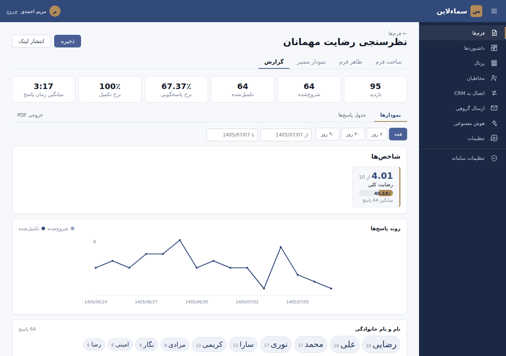
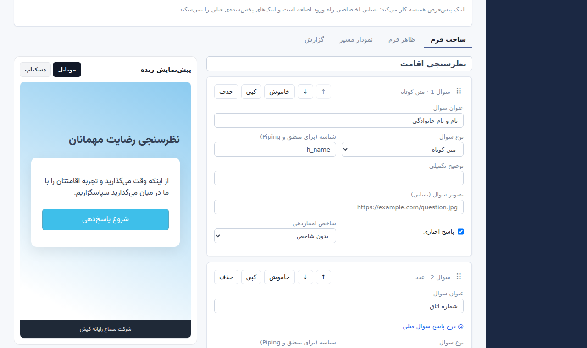
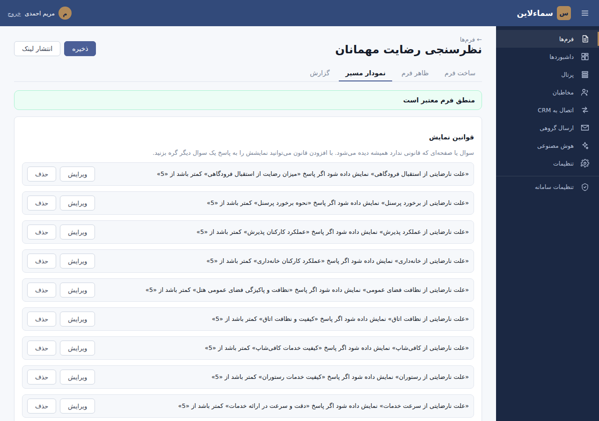
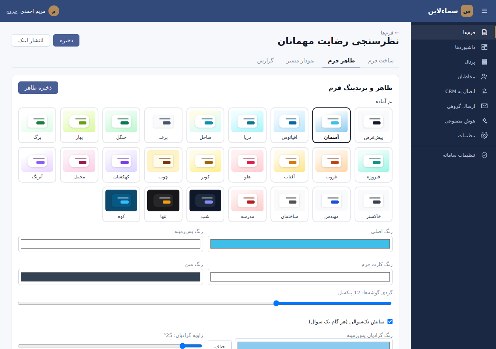
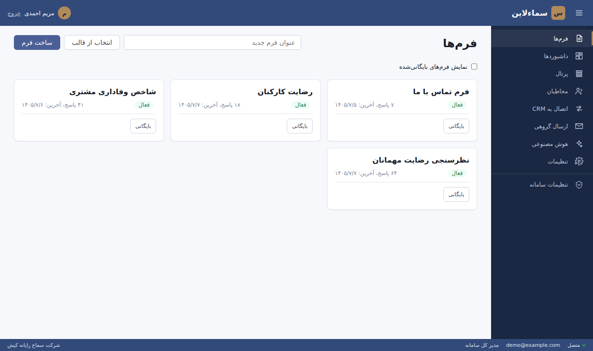
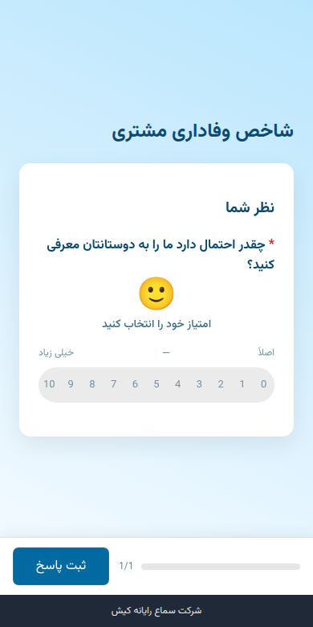

# سماء‌لاین (SamaLine)

**سامانه‌ی نظرسنجی، فرم‌ساز و گزارش‌گیری آنلاین — فارسی، راست‌به‌چپ و با تقویم شمسی.**

فرم بسازید، با لینک، QR، پیامک، کیوسک یا جاسازی در سایت منتشر کنید و پاسخ‌ها را
با نمودار، شاخص و خروجی اکسل تحلیل کنید. روی سرور خودتان با یک دستور نصب می‌شود؛
بدون Docker، بدون سرویس دیتابیس جداگانه و بدون وابستگی به هیچ سرویس خارجی.

نسخه‌ی ۱.۵.۰ — ساخته‌شده با Node.js (نسخه‌ی ۲۰ به بالا)، NestJS و React؛ دیتابیس SQLite یا PostgreSQL.

<p align="center">
  
</p>

<table>
  <tr>
    <td width="50%"></td>
    <td width="50%"></td>
  </tr>
  <tr>
    <td align="center">فرم‌ساز با پیش‌نمایش زنده</td>
    <td align="center">منطق شرطی: نمایش و پرش</td>
  </tr>
  <tr>
    <td width="50%"></td>
    <td width="50%"></td>
  </tr>
  <tr>
    <td align="center">۲۵ تم آماده، لوگو و رنگ سازمان</td>
    <td align="center">فرم‌ها با تعداد پاسخ</td>
  </tr>
</table>

<p align="center">
  <br>
  فرم پاسخ‌دهنده روی موبایل
</p>

---

## فهرست

- [امکانات](#features)
- [نصب روی سرور](#install) — یک دستور
- [به‌روزرسانی و نگهداری](#maintenance)
- [اجرا برای توسعه](#development)
- [تنظیمات و سرویس‌های بیرونی](#configuration)
- [راهنمای امکانات](#guide)
- [معماری](#architecture)
- [امنیت](#security)
- [وضعیت و نقشه‌ی راه](#status)

<a id="features"></a>

## امکانات

**ساخت فرم**
- ۲۴ نوع سوال: متن، عدد، موبایل، ایمیل، تاریخ شمسی، گزینه‌ای، لیست، امتیاز،
  NPS، ایموجی، اسلایدر، ماتریس، اولویت‌بندی، عکس‌دار، فایل، دوربین، صدا، امضا،
  موقعیت مکانی و…
- **۴۶ قالب آماده در ۱۵ صنف** با جستجو و فیلتر صنف؛ با یک کلیک فرم ساخته و در
  فرم‌ساز باز می‌شود ([فهرست کامل](#templates))
- پیش‌نمایش زنده (موبایل و دسکتاپ)، کشیدن و رها کردن سوال‌ها، بانک سوالات آماده
- منطق نمایش و پرش با شرط‌های «و/یا» تو در تو، حتی روی شاخص محاسبه‌شده؛ نمای
  فلوچارت مسیر
- Piping (درج پاسخ قبلی در متن سوال با `@`) و پارامتر مخفی از نشانی
- شاخص و وزن‌دهی با چهار روش تجمیع؛ نمایش نتیجه به پاسخ‌دهنده
- چندزبانه، ۲۵ تم آماده، لوگو، تصویر پس‌زمینه، صفحه‌ی شروع و پایان
- ساخت و بازبینی پرسشنامه با هوش مصنوعی (هر سرویس سازگار با OpenAI یا مدل داخلی)

**انتشار**
- لینک ثابت و نشانی اختصاصی خوانا (`/f/nazarsanji-1405`)، کد QR قابل چاپ
- جاسازی در سایت (iframe) و **پاپ‌آپ** روی سایت مشتری
- **کیوسک** برای تبلت لابی و پذیرش: فرم خالی برای هر نفر، ریست خودکار، تمام‌صفحه
- ارسال گروهی پیامک و ایمیل با لینک یکتای هر مخاطب، یادآوری خودکار فرم نیمه‌تمام
- پرتال: چند فرم روی یک صفحه
- ورود پاسخ‌دهنده با رمز یا کد یک‌بارمصرف پیامکی؛ جلوگیری از پاسخ تکراری
- PWA: اگر هنگام ثبت اینترنت قطع باشد، پاسخ روی دستگاه می‌ماند و بعدا ارسال می‌شود

**گزارش**
- بازدید، نرخ پاسخگویی و تکمیل، میانگین زمان پاسخ، روند روزانه با تاریخ شمسی
- نمودار مناسب هر نوع سوال، ابر کلمات برای پاسخ‌های متنی، نمودار رادار شاخص‌ها
- جدول پاسخ‌نامه‌ها با جستجو، فیلتر کامل/ناقص، منبع و IP، نمای کامل هر پاسخ
- داشبوردساز با اشتراک‌گذاری عمومی؛ خروجی اکسل، CSV و PDF (چاپ)
- گزارش هفتگی و اعلان پاسخ تازه در تلگرام

**اتصال به نرم‌افزارهای دیگر**
- وبهوک امضاشده با HMAC برای هر پاسخ کامل (مناسب Make/Zapier و سامانه‌های داخلی)
- همگام‌سازی مخاطبان از API هر CRM یا سامانه‌ی منابع انسانی با نگاشت فیلد
- REST API با مستندات Swagger

**سکو و مدیریت**
- چند سازمان روی یک نصب، با جداسازی کامل داده
- **تیم و نقش‌ها**: دعوت هم‌تیمی با لینک ایمیلی یک‌بارمصرف و پنج نقش
  (مالک، مدیر، ویرایشگر، تحلیلگر، بیننده) که روی همه‌ی مسیرهای API اعمال
  می‌شوند ([جزئیات](#team))
- پلن‌ها و سقف مصرف، اعمال‌شده روی همه‌ی امکانات ([جدول](#plans))؛ مدیریت پلن
  سازمان‌ها و انقضای خودکار از پنل مدیر کل
- ورود دومرحله‌ای (Google Authenticator و مانند آن)، تغییر رمز و بازیابی رمز با
  ایمیل؛ پس از تغییر رمز همه‌ی نشست‌های دیگر باطل می‌شوند
- پایش و ری‌استارت سرویس‌ها از پنل، پشتیبان روزانه‌ی خودکار، بررسی سلامت

<a id="install"></a>

## نصب روی سرور

یک سرور لینوکسی، یک دستور. سامانه یک پروسه‌ی Node است که با systemd روشن
می‌ماند؛ دیتابیس SQLite یک فایل است نه یک سرویس.

**پیش‌نیاز:** اوبونتو یا دبیان (یا هر لینوکس با systemd)، دسترسی root، git و
Node.js نسخه‌ی ۲۰ به بالا. حداقل ۱ گیگ رم و ۲ گیگ دیسک آزاد.

```bash
git clone https://github.com/kish210/SamaLine.git /opt/samaline
cd /opt/samaline
PUBLIC_URL=https://survey.example.com bash scripts/deploy.sh
```

| تنظیم | معنا |
| --- | --- |
| `PUBLIC_URL` | نشانی‌ای که کاربران با آن فرم را باز می‌کنند؛ لینک پیامک، ایمیل و یادآوری از روی آن ساخته می‌شود. اگر ندهید `http://IP:PORT` می‌شود. |
| `PORT` | پورت سامانه؛ پیش‌فرض ۸۰۸۰. اگر اشغال باشد اولین پورت آزاد بعدی انتخاب می‌شود. |
| `ALLOW_NODE_INSTALL=1` | اگر Node روی سرور نیست یا قدیمی است، خودش نصب کند. |

اسکریپت همه‌چیز را روی خودِ سرور انجام می‌دهد: نصب دقیق نسخه‌های قفل‌شده‌ی
وابستگی‌ها، build، ساخت فایل تنظیمات با کلیدهای تصادفی، ساخت سرویس systemd
(روشن شدن خودکار پس از ری‌بوت و بازگشت خودکار پس از خطا)، باز کردن پورت در
فایروال، و در پایان صبر تا وقتی سامانه واقعا بالا بیاید.

همه‌چیز از یک پورت سرو می‌شود:

| نشانی | چیست |
| --- | --- |
| `PUBLIC_URL/panel` | پنل مدیریت |
| `PUBLIC_URL/f/<token>` | فرم عمومی |
| `PUBLIC_URL/k/<token>` | همان فرم در حالت کیوسک |
| `PUBLIC_URL/api/docs` | مستندات API |
| `PUBLIC_URL/api/v1/health` | بررسی سلامت، برای پایشگر بیرونی |

### پس از اولین نصب

1. در پنل ثبت‌نام کنید، سپس خودتان را مدیر کل سامانه کنید:
   ```bash
   cd /opt/samaline/backend && npm run superadmin -- you@example.com
   ```
2. در «تنظیمات ← ورود دومرحله‌ای» ورود دومرحله‌ای حساب مدیر کل را روشن کنید.
3. پلن هر سازمان را از «تنظیمات سامانه ← سازمان‌ها و پلن‌ها» تعیین کنید.
   ثبت‌نام تازه با پلن رایگان شروع می‌شود و ارتقا فقط از همین‌جاست.
4. برای پیامک واقعی، در `backend/.env` مقدار `SMS_PROVIDER=kavenegar` و
   `KAVENEGAR_API_KEY` و `KAVENEGAR_SENDER` را بگذارید و
   `systemctl restart samaline` را بزنید.
5. برای ایمیل واقعی (لازم برای «فراموشی رمز» و دعوت‌نامه‌ها) در همان فایل:
   `EMAIL_PROVIDER=smtp` و `SMTP_HOST`، `SMTP_PORT`، `SMTP_USER`، `SMTP_PASS`
   و `SMTP_FROM`. توضیح را در خط جدا بنویسید، نه کنار مقدار.
6. پوشه‌ی `backend/data/backups/daily` را گه‌گاه به جایی بیرون از سرور کپی کنید.

### HTTPS

برای دامنه، ساده‌ترین راه Caddy است که گواهی را خودکار می‌گیرد و تمدید می‌کند.
فایل `/etc/caddy/Caddyfile`:

```
survey.example.com {
    reverse_proxy 127.0.0.1:8080
}
```

سپس `systemctl enable --now caddy` و یک بار دیگر
`PUBLIC_URL=https://survey.example.com bash scripts/deploy.sh`. nginx هم همین کار
را می‌کند؛ سامانه IP واقعی کاربر را از پراکسیِ روی همان سرور می‌پذیرد.

### نصب روی هاست cPanel

برای هاست اشتراکی با «Setup Node.js App»، نصاب تحت وب در
[installer/](installer/README.md) است.

<a id="maintenance"></a>

## به‌روزرسانی و نگهداری

```bash
cd /opt/samaline && bash scripts/update.sh
```

آخرین نسخه را از گیت می‌گیرد و همان استقرار را دوباره اجرا می‌کند. داده
(`backend/data/`)، کلیدها (`backend/.env`) و پورت دست نمی‌خورند و پیش از هر
تغییر ساختار دیتابیس، خودکار از آن پشتیبان گرفته می‌شود.

> سروری که با نسخه‌ی پیش از ۱.۳ نصب شده هنوز `update.sh` را ندارد؛ بار اول
> `git pull && bash scripts/deploy.sh` بزنید.

| کار | دستور |
| --- | --- |
| لاگ زنده | `journalctl -u samaline -f` |
| وضعیت | `systemctl status samaline` |
| راه‌اندازی مجدد | `systemctl restart samaline` |
| سلامت | `curl http://127.0.0.1:8080/api/v1/health` |
| تعیین یا لغو مدیر کل | `npm run superadmin -- email` / `-- email --revoke` / `-- --list` |
| خاموش کردن ورود دومرحله‌ای (گوشی گم‌شده) | `npm run reset-2fa -- email` |
| رمز موقت برای کاربر (وقتی ایمیل تنظیم نشده) | `npm run reset-password -- email` |

دستورهای `npm run` در پوشه‌ی `backend` اجرا می‌شوند. سرویس در پنل مدیر کل هم
دیده و ری‌استارت می‌شود. لاگ در journald است که خودش چرخش و سقف حجم دارد.

**پشتیبان:** روزی یک نسخه‌ی سازگار از دیتابیس در `backend/data/backups/daily/`
ساخته می‌شود و ۱۴ نسخه‌ی آخر می‌ماند (`DAILY_BACKUP_KEEP`). برای بازگرداندن:
سرویس را متوقف کنید، نسخه را جای `backend/data/samaline.sqlite` بگذارید و دوباره
روشن کنید.

<a id="development"></a>

## اجرا برای توسعه

پیش‌نیاز: فقط Node.js نسخه‌ی ۲۰ به بالا. هیچ سرویس دیگری لازم نیست.

```bash
npm run install:all       # نصب وابستگی هر سه بخش
cp backend/.env.example backend/.env
npm run dev               # بک‌اند، پنل و فرم با هم
```

| بخش | نشانی |
| --- | --- |
| پنل | http://localhost:5174/panel/ |
| فرم | http://localhost:5173 |
| API و Swagger | http://localhost:3000/api/docs |

در پنل ثبت‌نام کنید، یک فرم بسازید، «انتشار لینک» را بزنید و لینک را باز کنید.

**آزمون‌ها**

```bash
cd backend
npm test            # ۶۲۲ تست واحد و ادغام روی SQLite واقعی در حافظه
npm run lint        # اسلینت (بدون خطا)
npm run typecheck
npm run smoke       # چرخه‌ی کامل روی سرور در حال اجرا (BASE=...)
```

دود تست ثبت‌نام، ساخت فرم، انتشار، Piping، ثبت پاسخ، گزارش، خروجی، مخاطبان،
SSRF، فرم رمزدار، پرداخت، جداسازی سازمان‌ها و سلامت را می‌سنجد. سازمان تازه روی
پلن رایگان است، پس گام‌های منطق شرطی، کمپین پیامکی و داشبوردساز به‌طور پیش‌فرض
اعمالِ سقف پلن را می‌سنجند. برای اجرای همان گام‌ها روی امکانات واقعی، حساب مدیر
کل بدهید تا سازمانِ تست ارتقا یابد:

```bash
npm run superadmin -- admin@example.com
SMOKE_ADMIN_EMAIL=admin@example.com SMOKE_ADMIN_PASSWORD=... npm run smoke
```
 یک تست هم مطمئن می‌شود اسکیمای ساخته‌شده با
مهاجرت‌ها دقیقا همان است که کد می‌خواهد.

**ساخت نسخه‌ی تولید بدون اسکریپت استقرار:** `npm run build` در ریشه هر سه بخش
را می‌سازد؛ سپس `cd backend && npm run start:prod`. خودِ بک‌اند پنل و فرم را هم
سرو می‌کند و مهاجرت‌ها و پلن‌های پیش‌فرض را هنگام بالا آمدن اعمال می‌کند.

<a id="configuration"></a>

## تنظیمات و سرویس‌های بیرونی

همه در `backend/.env` (نمونه با توضیح: [backend/.env.example](backend/.env.example)).
هر سرویس بیرونی یک پیش‌فرض خوداتکا دارد، پس سامانه بدون هیچ حساب یا کلیدی
کامل کار می‌کند و با یک متغیر به سرویس واقعی وصل می‌شود.

| سرویس | پیش‌فرض | سرویس واقعی |
|---|---|---|
| پیامک | `local` — نوشتن در `data/outbox/sms.jsonl` | `kavenegar` یا `webhook` |
| ایمیل | `local` — نوشتن در `data/outbox/email.jsonl` | `smtp` (سرور ایمیل سازمان، Gmail، Zoho…) یا `webhook` |
| هوش مصنوعی | `mock` — بدون کلید و اینترنت | `openai` (هر سرویس سازگار، شامل مدل داخلی) |
| درگاه پرداخت | `local` — فقط برای آزمایش | `zarinpal` |
| صف ارسال | صف پایدار روی خود دیتابیس | — (Redis لازم نیست) |

| دیتابیس | تنظیم | توضیح |
|---|---|---|
| SQLite (پیش‌فرض) | `DB_DRIVER=sqlite` | فایل `backend/data/samaline.sqlite` |
| PostgreSQL | `DB_DRIVER=postgres` و `DATABASE_URL` | پیش از به‌روزرسانی با `pg_dump` پشتیبان بگیرید |

در هر دو حالت مهاجرت‌ها هنگام بالا آمدن خودکار اجرا می‌شوند.

<a id="guide"></a>

## راهنمای امکانات

<a id="templates"></a>

### قالب‌های آماده

هر قالب یک فرم کامل و قابل ویرایش است: سوال‌های رایج آن صنف، سوال پیگیری
شرطی (مثلا «چرا؟» فقط وقتی امتیاز پایین است، یا سوال پیک فقط برای سفارش ارسالی)،
شاخص رضایت برای گزارش، و تم هم‌خوان. همه روی پلن رایگان هم ساخته می‌شوند.
از «فرم‌ها ← انتخاب از قالب» قالب را انتخاب کنید؛ عنوان خودکار پر می‌شود و
«ساخت فرم از این قالب» فرم را مستقیم در فرم‌ساز باز می‌کند.

| صنف | قالب‌ها |
|---|---|
| عمومی | فرم خالی، فرم تماس، صندوق پیشنهاد و انتقاد (ناشناس)، نظرخواهی سریع، نمونه‌ی همه‌ی انواع سوال |
| تجربه مشتری | NPS، رضایت مشتری (CSAT)، سهولت انجام کار (CES)، بازخورد محصول، ارزیابی پشتیبانی، ثبت شکایت |
| فروشگاه و خرید آنلاین | رضایت پس از خرید اینترنتی، رضایت از فروشگاه حضوری، بازخورد وب‌سایت و اپلیکیشن |
| رستوران و کافه | نظرسنجی رستوران، نظرسنجی سریع کافه (QR روی میز) |
| گردشگری و هتلداری | رضایت مهمانان هتل، هتل بر پایه‌ی خدمات استفاده‌شده، ارزیابی تور و آژانس |
| بانک، بیمه و خدمات مالی | رضایت مشتریان شعبه، ارزیابی پرداخت خسارت بیمه |
| درمان و سلامت | رضایت بیماران، درخواست نوبت مطب و درمانگاه |
| آموزش | ارزشیابی درس و مدرس، رضایت اولیا از مدرسه، ثبت‌نام دوره و کارگاه |
| منابع انسانی | رضایت کارکنان، درخواست استخدام، ارزیابی ماه اول، ارزیابی ۳۶۰ درجه، مصاحبه‌ی خروج، ارزیابی دوره‌ی آموزشی، رفاه و سلامت روان (ناشناس)، درخواست مرخصی، رضایت از پشتیبانی IT |
| بازاریابی و پژوهش بازار | پژوهش بازار، آگاهی و تصویر برند، درخواست مشاوره و خرید |
| رویداد | بازخورد رویداد، ثبت‌نام رویداد و همایش |
| خدمات عمومی و شهری | سنجش رضایت ارباب رجوع، گزارش مشکل شهری (با نقشه و عکس) |
| ساختمان و املاک | نظرسنجی ساکنان مجتمع |
| حمل‌ونقل و خودرو | خدمات پس از فروش خودرو، ارزیابی سفر و راننده |
| ورزش و تندرستی | رضایت اعضای باشگاه ورزشی |

قالب‌ها در `backend/src/templates/` تعریف می‌شوند. برای افزودن قالب تازه، یک
مورد به `sector-templates.ts` اضافه کنید؛ آزمون‌ها خودکار بررسی می‌کنند که
قوانین شرطی با موتور منطق واقعی درست کار کنند، سقف شاخص با مقیاس سوال‌ها بخواند
و قالب روی پلن رایگان ساخته شود.

<details>
<summary><b>کیوسک</b></summary>

نشانی فرم را با `/k/` به‌جای `/f/` باز کنید (پنل ← انتشار فرم ← «کیوسک»). هر
نفر فرم خالی می‌بیند؛ پاسخ نفر قبل هرگز به نفر بعد نشان داده نمی‌شود. پس از ثبت،
فرم خودکار برای نفر بعد آماده می‌شود و فرم نیمه‌کاره پس از دو دقیقه بی‌کاری پاک
می‌شود. تنظیم در نشانی: `?reset=10` (ثانیه‌های صفحه‌ی تشکر) و `?idle=180`
(ثانیه‌های بی‌کاری). رفتن بین صفحات فرم اینترنت می‌خواهد؛ فقط ثبت نهایی در
قطعی ذخیره و بعدا ارسال می‌شود.
</details>

<details>
<summary><b>لینک اختصاصی فرم</b></summary>

هر فرم یک لینک توکنی دارد که همیشه معتبر می‌ماند. در تب «ساخت فرم» می‌توان
نشانی خوانایی هم گذاشت:

```
https://survey.example.com/f/0904bbb1011e6027010b77861ce67795   ← پیش‌فرض
https://survey.example.com/f/nazarsanji-1405                    ← اختصاصی
```

نشانی اختصاصی برای بروشور و پیامک مناسب است و لینک‌های پخش‌شده‌ی قبلی را
نمی‌شکند، چون هر دو راه معتبرند.
</details>

<details>
<summary><b>وبهوک</b></summary>

پنل ← تنظیمات ← وبهوک. با هر پاسخ کامل، یک درخواست `POST` با بدنه‌ی JSON
(رویداد `response.completed`: فرم، پاسخ‌ها و شاخص‌ها) به نشانی مقصد می‌رود. اگر
مقصد در دسترس نباشد، تا پنج بار با فاصله‌ی فزاینده دوباره تلاش می‌شود و ری‌استارت
سرور رویداد را گم نمی‌کند. اصالت درخواست با سربرگ زیر سنجیده می‌شود:

```
X-SamaLine-Signature: sha256=<hex(HMAC-SHA256(راز وبهوک، بدنه‌ی خام))>
```
</details>

<details>
<summary><b>اتصال مخاطبان به CRM</b></summary>

اگر فهرست افراد در یک CRM، سامانه‌ی منابع انسانی یا باشگاه مشتریان است، از منوی
«اتصال به CRM» مستقیم به دفترچه‌ی مخاطبان وصلش کنید:

1. نشانی API، هدر احراز هویت و مسیر آرایه در پاسخ را بدهید.
2. کلیدهای پاسخ را به فیلدهای سامانه نگاشت کنید (فیلد تو در تو با نقطه: `profile.phone`).
3. با «پیش‌نمایش» چند رکورد اول را ببینید، سپس ذخیره و همگام‌سازی کنید.

شماره‌ی موبایل خودکار یکسان‌سازی می‌شود (`+98`، `0098`، ارقام فارسی و عربی) و
کلیدهای نگاشت‌نشده متغیر شخصی‌سازی پیام می‌شوند. همگام‌سازی دوباره رکورد تکراری
نمی‌سازد.
</details>

<a id="plans"></a>
<details>
<summary><b>پلن‌ها و اعمال سقف‌ها</b></summary>

سقف‌ها و امکانات هر پلن در «تنظیمات سامانه ← سازمان‌ها و پلن‌ها» قابل تغییرند و
سر ذخیره یا استفاده اعمال می‌شوند، نه فقط سر نمایش؛ پس از راه API هم دور زده
نمی‌شوند:

| چه چیزی | کجا بررسی می‌شود |
| --- | --- |
| تعداد فرم فعال، پاسخ‌نامه‌ی ماهانه، انواع سوال | ساخت فرم و ثبت پاسخ |
| منطق شرطی نمایش، منطق پرش، شاخص، چندزبانه | ذخیره‌ی ساختار فرم |
| کیوسک، پرتال، پرسشگر، Embed و Pop-up | ساخت آن نوع انتشار (شمارش روی کل سازمان) |
| پنل پیامکی و ایمیلی | ارسال تکی و کمپین |
| داشبوردساز، وبهوک، کلید API | ساخت هرکدام |
| اکسل/CSV پیشرفته | خروجی با `advanced=true` (خروجی ساده برای همه باز است) |
| ساخت، بازنگری و تحلیل با هوش مصنوعی | همان مسیرها |
| کاربر سازمان | دعوت هم‌تیمی و پذیرش دعوت |

**قالب آماده روی پلن پایین‌تر**: قالب‌ها منطق شرطی و شاخص دارند. به‌جای رد کردن
ساخت، آنچه پلن ندارد کنار گذاشته می‌شود و فرم با همه‌ی سوال‌هایش ساخته می‌شود؛
پنل فهرست چیزهای کنارگذاشته‌شده را نشان می‌دهد. همان منطق اگر مستقیم در درخواست
بیاید رد می‌شود، پس این راه دور زدن پلن نیست.
</details>

<a id="team"></a>
<details>
<summary><b>تیم و نقش‌ها</b></summary>

هر سازمان می‌تواند چند کاربر با نقش‌های جدا داشته باشد. نقش‌ها از بالا به پایین،
و هر نقش همه‌ی اختیارات نقش‌های پایین‌تر را دارد:

| نقش | چه کاری می‌تواند بکند |
| --- | --- |
| **مالک** | همه‌چیز، از جمله دادن و گرفتن نقش مالک |
| **مدیر** | تیم، کلید API، وبهوک، تلگرام، فاکتور و همه‌ی کارهای ویرایشگر |
| **ویرایشگر** | ساخت، ویرایش و انتشار فرم، کمپین پیامک و ایمیل، مخاطبان |
| **تحلیلگر** | گزارش، داشبوردساز، خروجی اکسل و CSV، یادداشت روی پاسخ‌نامه |
| **بیننده** | فقط دیدن فرم‌ها و گزارش‌ها، بدون خروجی گرفتن از داده‌ی شخصی |

دعوت از «تنظیمات ← تیم» انجام می‌شود:
لینک یک‌بارمصرف هفت‌روزه هم به ایمیل دعوت‌شده می‌رود و هم به دعوت‌کننده نشان
داده می‌شود، پس اگر SMTP تنظیم نشده باشد می‌شود همان لینک را در پیام‌رسان
فرستاد. در دیتابیس فقط هش لینک ذخیره می‌شود.

کارت «تیم» فقط برای مالک و مدیر دیده می‌شود، مثل وبهوک و تلگرام. کسی که از قبل
حساب دارد با رمز خودش (و کد ورود دومرحله‌ای، اگر روشن است) دعوت را
می‌پذیرد و بعد با انتخابگر سازمان در نوار بالای پنل بین سازمان‌هایش جابه‌جا
می‌شود؛ بقیه همان‌جا حساب می‌سازند.

نکته‌های امنیتی:

- نقش هر درخواست، هر بار از دیتابیس خوانده می‌شود؛ حذف کسی از تیم، نشست‌های
  فعالش را بی‌درنگ باطل می‌کند (پاسخ ۴۰۱).
- سازمان همیشه دست‌کم یک مالک دارد: آخرین مالک نه پایین می‌آید و نه حذف می‌شود،
  و فقط مالک می‌تواند نقش مالک بدهد یا بگیرد.
- سقف کاربران پلن، دعوت‌های در انتظار را هم می‌شمارد و هنگام پذیرش دوباره بررسی
  می‌شود؛ پلن رایگان یک کاربر دارد.
- مسیری که فراموش شود تزئین نقش بخورد باز نمی‌ماند: پیش‌فرض امن یعنی خواندن
  دست‌کم «بیننده» و هر تغییری دست‌کم «ویرایشگر».
</details>

<details>
<summary><b>مدیر کل سامانه</b></summary>

نقشی برای گرداننده‌ی سکو، جدا از نقش‌های هر سازمان. تنظیمات سراسری (نوار پایین
فرم‌ها، پلن سازمان‌ها، ربات تلگرام، پایش سرویس‌ها) را کنترل می‌کند. تعیین و لغو
فقط از خط فرمان سرور ممکن است و هیچ راهی از پنل برای ارتقای خود وجود ندارد.
دسترسی هر بار از دیتابیس خوانده می‌شود، پس لغو نقش بلافاصله اثر می‌کند.
</details>

<details>
<summary><b>لوگو و ظاهر</b></summary>

«ظاهر فرم» ← «انتخاب فایل لوگو». فایل‌ها در `backend/data/uploads/` ذخیره و از
`/uploads/` سرو می‌شوند؛ سقف ۲ مگابایت، فقط PNG/JPG/WEBP/GIF/SVG. پنل مدیریت از
پالت برند سماع پیروی می‌کند (`panel/src/tokens.css`)، ولی فرمِ پاسخ‌دهنده عمدا
تم‌پذیر است تا برند مشتری را نشان دهد.
</details>

<a id="architecture"></a>

## معماری

```
backend/          NestJS + TypeORM — API، منطق فرم، صف، گزارش؛ پنل و فرم را هم سرو می‌کند
  forms/          موتور منطق (اعتبارسنجی و اجرا) و موتور شاخص
  public/         فرم عمومی، پیمایش صفحات، ثبت پاسخ، پرتال
  messaging/      پیامک و ایمیل، صف پایدار، کمپین
  integrations/   وبهوک و تلگرام
  reports/        گزارش، نمودار، خروجی، داشبوردساز
panel/            پنل مدیریت (React + Vite)
form-renderer/    اپ سبک پاسخ‌دهنده، PWA (React + Vite)
scripts/          استقرار و به‌روزرسانی
installer/        نصاب cPanel
```

**منطق فرم فقط یک پیاده‌سازی دارد و آن سمت سرور است.** فرم برای هر گام، صفحه
و سوال‌های قابل نمایش را از سرور می‌گیرد، و پاسخ سوالی که پنهان بوده هنگام ثبت
حذف می‌شود؛ پس منطق از سمت مرورگر دور زدنی نیست.

<a id="security"></a>

## امنیت

- جداسازی کامل سازمان‌ها: هیچ کاربری به فرم، پاسخ، انتشار، کمپین یا پلن سازمان
  دیگر دسترسی ندارد؛ این در دود تست هم سنجیده می‌شود.
- تغییر پلن و صدور لایسنس فقط برای مدیر کل.
- ۱۰ رمز اشتباه برای یک حساب، آن را ۱۵ دقیقه قفل می‌کند؛ ورود دومرحله‌ای اختیاری.
- وبهوک و اتصال CRM به شبکه‌ی داخلی سرور درخواست نمی‌زنند (محافظت SSRF). برای
  سرویسی که واقعا داخل شبکه‌ی سازمان است: `ALLOW_PRIVATE_CONTACT_SOURCES=true`.
- کلیدهای API سرویس‌های بیرونی و کلید ورود دومرحله‌ای رمزشده (AES-256-GCM)
  ذخیره می‌شوند.
- `PAYMENT_PROVIDER` پیش‌فرض `local` هر پرداختی را موفق می‌شمارد. چون پرداخت پلنی
  را فعال نمی‌کند بی‌خطر است، ولی برای دریافت وجه واقعی `zarinpal` کنید.
- سرویس با root اجرا می‌شود تا پنل مدیر کل بتواند آن را ری‌استارت کند. اگر این
  امکان را نمی‌خواهید، در فایل سرویس `User=` بدهید و مالکیت پوشه را به همان
  کاربر بدهید.

<a id="status"></a>

## وضعیت و نقشه‌ی راه

هسته‌ی سامانه کامل و آماده‌ی بهره‌برداری است. آنچه هنوز ساخته نشده، با توضیح
اینکه الان چه چیزی به‌جایش هست، در [REMAINING.md](REMAINING.md) آمده است؛ از
جمله خرید آنلاین پلن، خروجی PowerPoint، ورود پاسخ‌دهنده با OAuth/LDAP و اپ
موبایل.

شرح کامل محصول، نقشه‌ی راه و گزارش ممیزی هر نسخه: [todo.md](todo.md).
